<p align="center">
  
</p>

<p align="center">
  Timetable, attendance, deadlines, a focus timer, gym, food and daily goals in one app that installs on your phone or laptop.
</p>

<p align="center">
  <a href="https://rehaan15790.github.io/productivity-app/"></a>
</p>

<p align="center">
  <a href="#install">Install</a> ·
  <a href="#whats-in-it">What's in it</a> ·
  <a href="#back-up-your-data">Back up your data</a> ·
  <a href="#how-its-built">How it's built</a> ·
  <a href="#suggest-a-feature">Suggest a feature</a>
</p>

## Install

| Device | How |
| --- | --- |
| Android (Chrome) | Open the link, tap ⋮, then **Install app**. |
| iPhone (Safari) | Tap Share, then **Add to Home Screen**. |
| Laptop (Chrome or Edge) | Click the install icon at the right end of the address bar. |

It works offline, and your data stays on your own device.

## What's in it

- **Today.** The class on now or next, a reminder to mark attendance, the next exam, deadlines for the next two weeks, a focus timer (or log study time you did elsewhere) and a summary of your week or month.
- **Classes.** Attendance per subject, how many classes you can still miss before the semester ends, a planner for a day off, the timetable, a month calendar, deadlines and holidays.
- **Health.** Workouts with best-set tracking and notes, cardio, food by meal, water, daily goals with a four-week history, weight and waist. You can log any of these for an earlier day.
- **Settings.** Choose which sections show, your attendance target and last day of classes, light or dark theme, and backups.

### First open

Pick how to start: Division A batch A2's timetable, your own batch's classes, a blank start, or gym and health only. You can change what the app shows later in **Settings**.

## Back up your data

> [!IMPORTANT]
> Your data lives only in this browser. Go to **Settings → Your data → Download a backup** now and then, and keep the file somewhere safe. **Restore** puts it back, on this device or a new one.

## How it's built

The whole app is one `index.html` of plain HTML, CSS and JavaScript, with no build step and no framework. GitHub Pages serves it straight from this repository.

- **Storage.** Everything you enter is kept in the browser's `localStorage`, and the app asks the browser to keep that storage instead of clearing it when space runs low. Backups are JSON files.
- **Offline.** `sw.js` is a service worker. It loads the page from the network when it can and falls back to its cached copy when you are offline. It also caches the manifest, the icons and the fonts.
- **Install.** `manifest.webmanifest` gives the app its name, icons and theme colour, so phones and laptops can install it.

To run it locally, serve the folder with any static server and open it in a browser:

```bash
python -m http.server 8000
```

Then open `http://localhost:8000`. Service workers only run on `localhost` or HTTPS, so opening `index.html` as a file skips offline mode.

## Suggest a feature

Use **Settings → Suggest a change** in the app, or [open an issue](https://github.com/Rehaan15790/productivity-app/issues/new) here. Everyone can see and upvote ideas in [Issues](https://github.com/Rehaan15790/productivity-app/issues).
